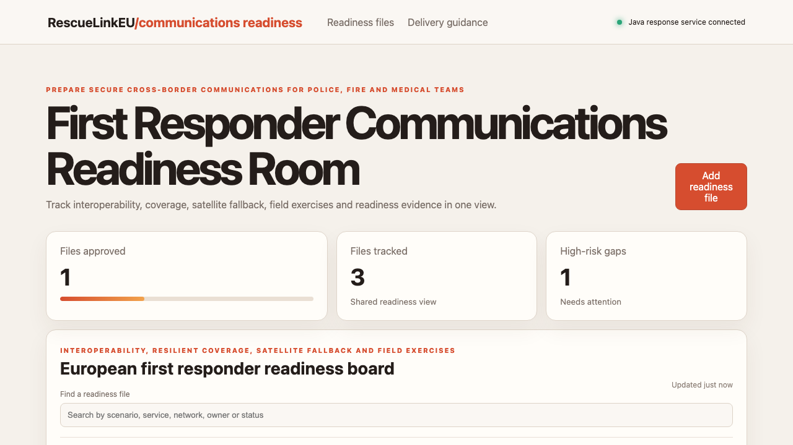

# First Responder Communications Readiness Room

## One-sentence benefit

Prepare interoperable and resilient communications for police, fire, medical and civil-protection teams.

## Live demo

[Watch the workflow](docs/demo.webm).

## Screenshots

## Main features

- Search readiness files by scenario, service, network or owner.
- Create communications work through the Spring Boot API.
- Advance files through draft, review and approved states.
- Show live metrics and clear loading, empty and error feedback.
- Provide operational and delivery-guidance sections.

## Technology used

Angular, TypeScript, signals, computed state, OnPush change detection, Spring Boot and Java 21.

## Installation instructions

Install Node.js 22 and Java 21. Run `npm install`, then start the backend with `cd backend && mvn spring-boot:run`. In another terminal run `npm start`.

## Commercial licensing/contact

Commercial licensing and integration support are available. Use the repository contact options to discuss deployment.

## Business problem and users

Emergency services, network operators and civil-protection teams need to coordinate interoperability, coverage, fallback channels and exercise evidence.

## Key workflows

Search readiness work, create an exercise file, review ownership and risk, advance its state and confirm the persisted API result.

## Angular framework highlights

Signals and computed values manage local views, Angular HttpClient performs real API work, control flow renders states and OnPush limits unnecessary change detection.

## Java backend highlights

Spring Boot separates controller, service and domain concerns while providing validated CRUD-style APIs, health reporting, clear errors and Java tests.

## Architecture and state flow

Angular calls `/api/items` through its proxy. Validated requests enter the controller, workflow logic runs in the service and signals update from returned records.

## Accessibility and responsive behaviour

Semantic sections, associated labels, strong contrast, keyboard controls and responsive grids make the workflow usable across devices.

## Verification commands

Run `npm test`, `npm run build`, `cd backend && mvn test` and `cd backend && mvn package`.

## Structure

`src/app` contains the Angular experience, `backend` contains the Java service, and `docs` contains inspected media.

## Tradeoffs

Records are held in memory for a simple demonstration. Production rollout needs authentication, audit-grade persistence and trust-service integrations.

## Roadmap

Add coverage maps, incident channels, exercise observations and cross-border service roles.
